<p align="center">
  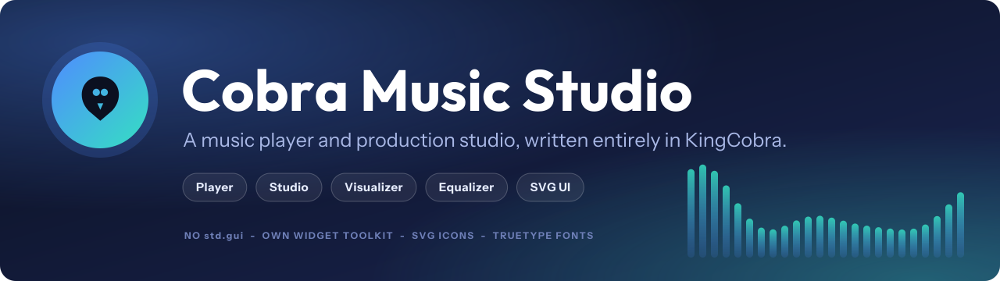
</p>

<p align="center">
       
</p>

<p align="center">
  <b>A complete music player and production studio, written entirely in <a href="https://github.com/DivyanshuSinha136">KingCobra</a>.</b><br>
  It does not use <code>std.gui</code>: the widget toolkit, the SVG renderer and the font renderer are all KingCobra code.
</p>

<p align="center">
  <a href="#overview">Overview</a> &middot;
  <a href="#screenshots">Screenshots</a> &middot;
  <a href="#features">Features</a> &middot;
  <a href="#quick-start">Quick start</a> &middot;
  <a href="#studio-workflow">Studio</a> &middot;
  <a href="#architecture">Architecture</a> &middot;
  <a href="#graphics">Graphics</a> &middot;
  <a href="#testing">Testing</a>
</p>

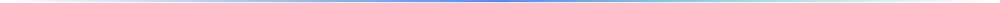

<h2 id="overview">&nbsp;Overview</h2>

Cobra Music Studio combines three programs in one window:

* a **music player** with a library, playlists, queue, equalizer and live visualizers,
* a **production studio** with a step sequencer, a piano-roll editor and a multi-track mixer,
* a **graphics stack** (vector icons, TrueType text, anti-aliased shapes) built from scratch on top of the plain 2D canvas of `std.game`.

Rendering and playback use the KingCobra standard library only: `std.game` for the canvas and input, `std.music_note` for synthesis and DSP, `std.system` for processes and files, `std.json` for state. About 7,000 lines of KingCobra, no native extensions.

<table>
<tr><td width="33%" valign="top"><br><b>Full-featured player</b><br><sub>Seek by waveform, queue, shuffle, repeat, speed, sleep timer, loudness matching.</sub></td><td width="33%" valign="top"><br><b>10-band equalizer</b><br><sub>Presets, live response curve, bass shelf, stereo width, reverb, compressor, limiter.</sub></td><td width="33%" valign="top"><br><b>Real-time visualizers</b><br><sub>Six FFT-driven modes, five palettes, stereo VU meters, beat pulse.</sub></td></tr>
<tr><td width="33%" valign="top"><br><b>Production studio</b><br><sub>Step sequencer, piano roll, 8-track mixer, sampler, sidechain, stems, MIDI.</sub></td><td width="33%" valign="top"><br><b>Score view</b><br><sub>Scrolling piano roll with playhead for generated and notation tracks.</sub></td><td width="33%" valign="top"><br><b>Custom graphics stack</b><br><sub>Own SVG rasteriser, TrueType renderer and widget toolkit, all in KingCobra.</sub></td></tr>
</table>


<h2 id="screenshots">&nbsp;Screenshots</h2>

<table>
<tr><td width="50%" valign="top"><a href="docs/screenshots/player.png">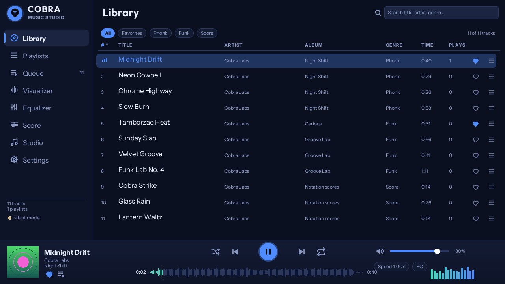</a><br><b>Library and player</b><br><sub>Sortable library, waveform seek bar, mini spectrum.</sub></td><td width="50%" valign="top"><a href="docs/screenshots/studio-sequencer.png">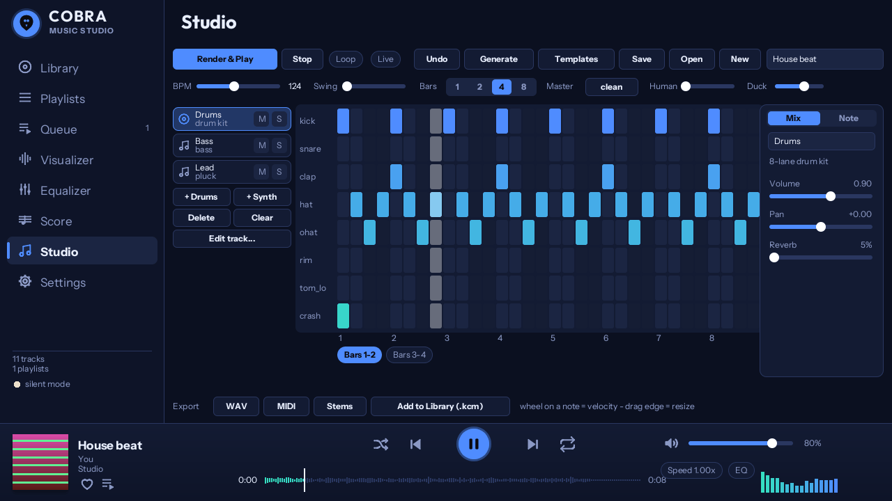</a><br><b>Studio: step sequencer</b><br><sub>Drum lanes with accents and ghost notes, mixer panel.</sub></td></tr>
<tr><td width="50%" valign="top"><a href="docs/screenshots/studio-pianoroll.png">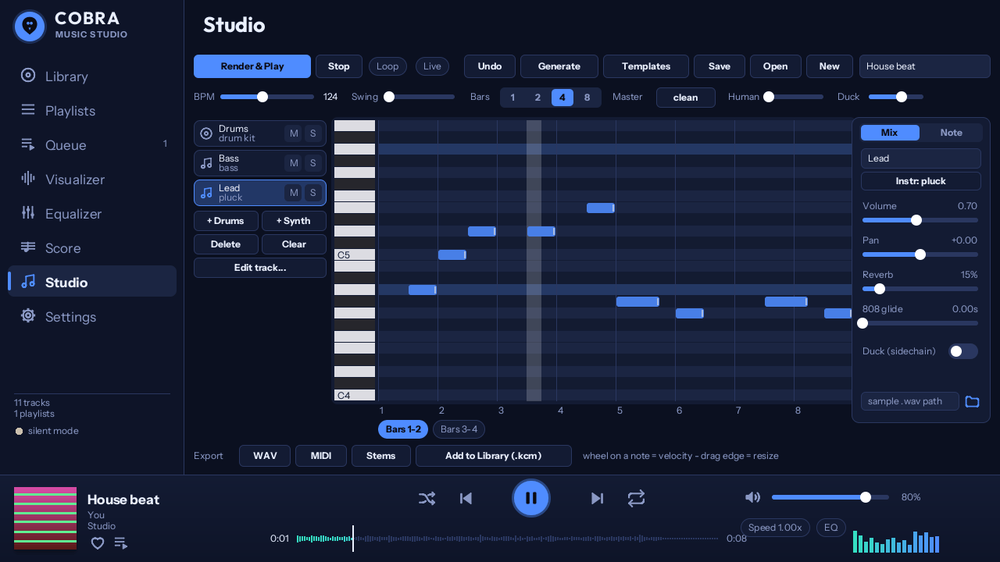</a><br><b>Studio: piano roll</b><br><sub>Velocity, chord stamp, drag to move and resize notes.</sub></td><td width="50%" valign="top"><a href="docs/screenshots/visualizer-radial.png">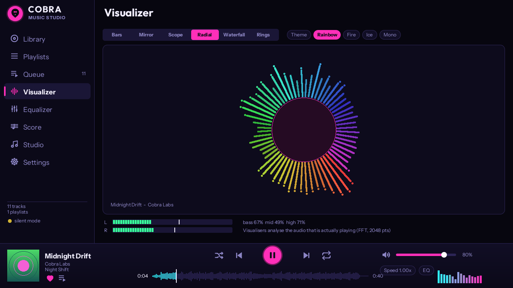</a><br><b>Visualizer: radial</b><br><sub>Rainbow palette in the Neon theme.</sub></td></tr>
<tr><td width="50%" valign="top"><a href="docs/screenshots/equalizer.png">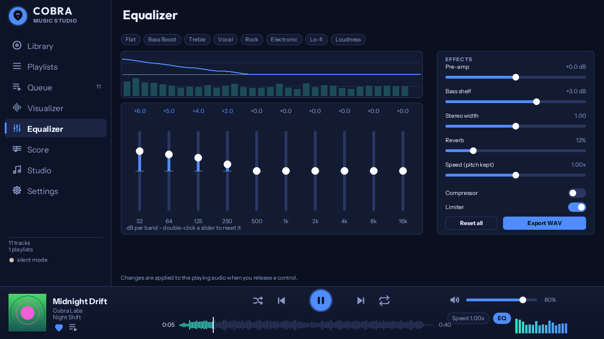</a><br><b>Equalizer and effects</b><br><sub>Bass Boost preset with live response curve.</sub></td><td width="50%" valign="top"><a href="docs/screenshots/score.png">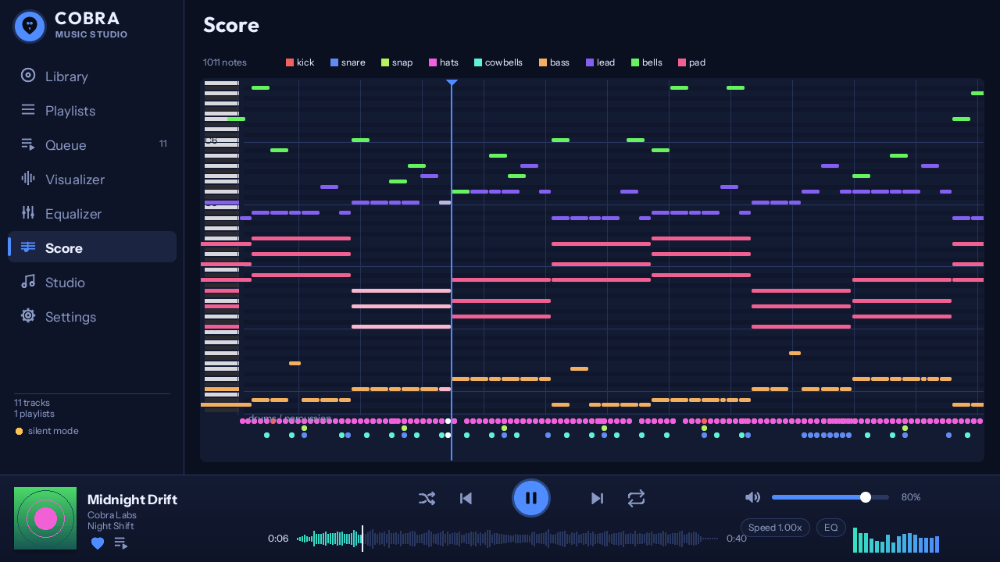</a><br><b>Score view</b><br><sub>Piano roll of the playing arrangement.</sub></td></tr>
</table>

<details>
<summary><b>Five themes</b> (Midnight is the default and is shown above)</summary>
<br>
<table><tr><td width="25%"><a href="docs/screenshots/theme-neon.png">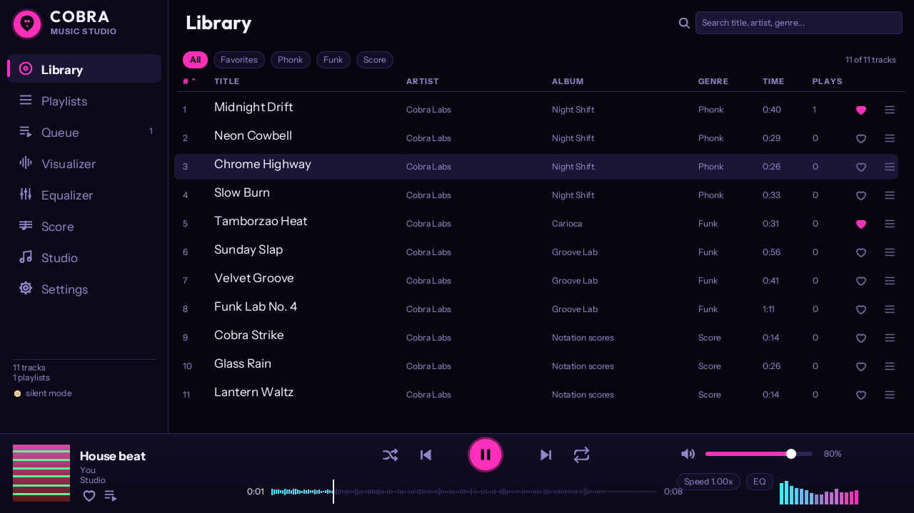</a><br><sub><b>Neon</b></sub></td><td width="25%"><a href="docs/screenshots/theme-sunset.png">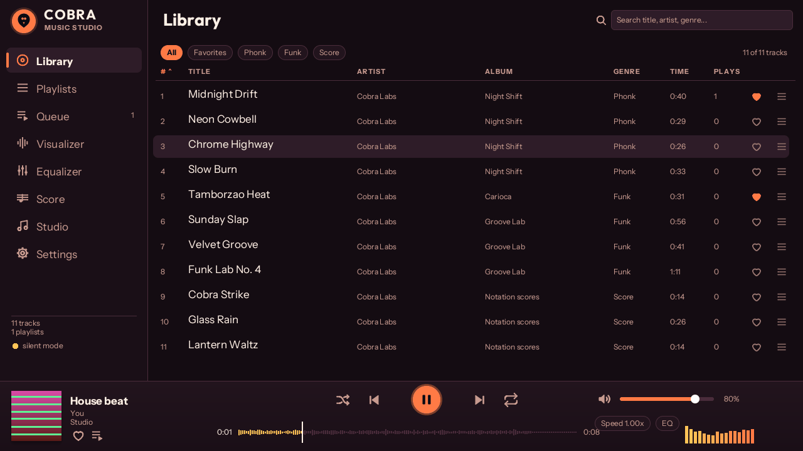</a><br><sub><b>Sunset</b></sub></td><td width="25%"><a href="docs/screenshots/theme-forest.png">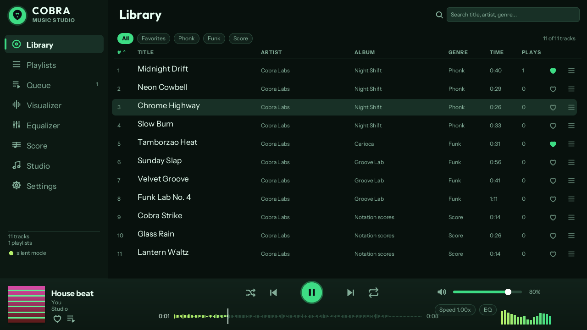</a><br><sub><b>Forest</b></sub></td><td width="25%"><a href="docs/screenshots/theme-paper.png">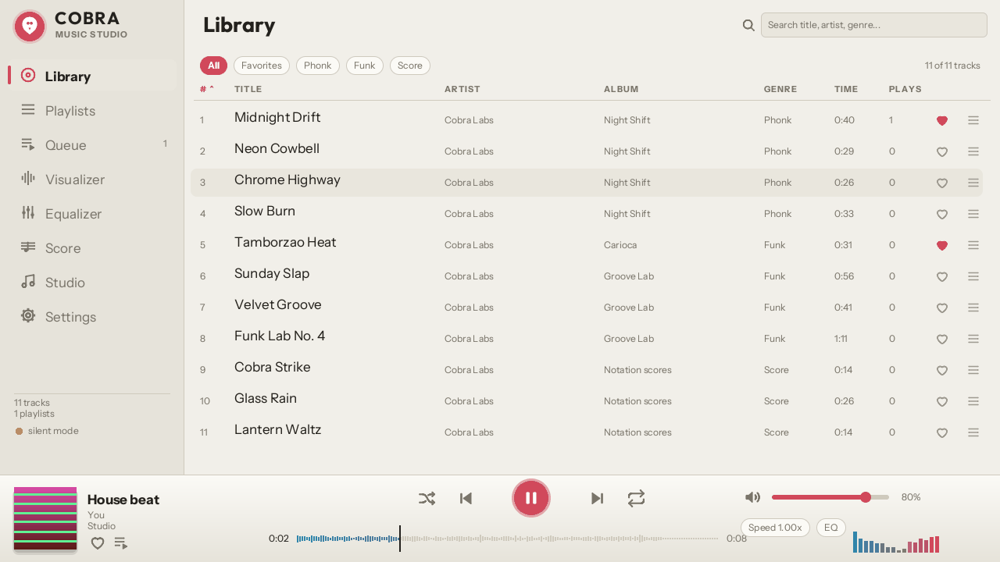</a><br><sub><b>Paper</b></sub></td></tr></table>
</details>


<h2 id="features">&nbsp;Features</h2>

###  Library

* Built-in generated tracks, notation scores (`.kcm`), and any `.wav` in your folders; `mp3`, `flac`, `ogg`, `m4a` and `opus` too when `ffmpeg` is installed.
* Search across title, artist, album and genre. Genre filters. Sortable columns. Favorites, play counts, recently played, most played.
* Right-click menu: play, play next, add to queue, add to playlist, favorite, track info.
* Heavy renders run in a **background KingCobra process**, so the window never freezes. The next queued track is prefetched.

###  Playback

* Play, pause, previous (with history), next, shuffle, repeat off / all / one, volume, mute, sleep timer.
* Click or drag the **waveform** to seek. Pitch-preserving speed from 0.5x to 1.5x.
* **Loudness matching** brings tracks to a similar level without ever pushing peaks into clipping.
* Non-blocking output through the system player (`pw-play`, `paplay`, `aplay`, `ffplay`, `afplay`, Windows SoundPlayer). With no audio device the app falls back to a simulated clock, so everything stays usable.

###  Equalizer and effects

* 10 bands (32 Hz to 16 kHz), presets, live frequency-response curve with the spectrum behind it.
* Pre-amp, bass shelf, stereo width, reverb, compressor, limiter, export the processed track to WAV.

###  Visualizers

* Bars, mirror, scope, radial, waterfall and rings, driven by a real 2048-point FFT of the audio that is playing.
* Five palettes, stereo VU meters with peak hold, beat detection that pulses the logo and cover art.

###  Production studio

* **Step sequencer**: 8 drum lanes, up to 8 bars, drag-paint, accents and ghost notes.
* **Piano roll**: scale highlighting, note preview, drag to move, drag the edge to resize, mouse wheel for velocity, chord stamp (triad, 7th, power, sus4), 808 slide.
* **Mixer**: up to 8 tracks, 20 synth instruments or your own **WAV sampler**, per-track volume / pan / reverb / mute / solo, **sidechain ducking** from the kick, humanize, swing, mastering presets.
* **Generators**: House, Trap, Funk, Lo-fi templates; random patterns, arpeggios, chord progressions, basslines, drum fills.
* **Workflow**: 40-step undo, Live mode (re-renders while you edit), project save / open, crash-recovery autosave.
* **Export**: WAV, MIDI, one WAV per track (stems), or add the score to your library as `.kcm`.

###  Robustness

* Every frame is guarded: a bug in one screen is written to `error.log` and the music keeps playing; repeated faults fall back to the library.
* Settings are validated on load, the render cache has a size limit with oldest-first eviction, and a diagnostics panel shows the environment.


<h2 id="quick-start">&nbsp;Quick start</h2>

| Requirement | Notes |
|---|---|
| KingCobra 1.0 or newer | `kingcobra --version` |
| An audio player (optional) | one of `pw-play`, `paplay`, `aplay`, `ffplay`, `afplay` (Windows uses the built-in SoundPlayer) |
| `ffmpeg` (optional) | enables mp3 / flac / ogg / m4a / opus import |

```bash
# open the window (1280x720)
kingcobra run main.kc

# larger window
kingcobra run main.kc --size 1600x900

# no audio device: simulate playback (also useful on servers)
KC_MUSIC_SILENT=1 kingcobra run main.kc

# no display: render frames headlessly (used by the tests)
kingcobra run main.kc --headless
```

| Environment variable | Purpose |
|---|---|
| `KC_MUSIC_SILENT=1` | force silent mode with a simulated clock |
| `KC_MUSIC_HOME` | data directory (default `~/.cobra_music`) |
| `KC_MUSIC_APP` | application directory, set automatically at start-up |

Add your music by opening **Settings** and adding a folder path, or drop files into the `music/` folder.


<h2 id="studio-workflow">&nbsp;Studio workflow</h2>

1. Open **Studio** (key `8`) and pick a template from **Templates**, or start from the blank project.
2. Click cells in the sequencer to place drums. Right-click a step to cycle normal, accent and ghost.
3. Select a synth track and click the piano roll to add notes. Drag a note to move it, drag its right edge to resize it.
4. Shape the sound in the **Mix** tab: instrument or sample, volume, pan, reverb, 808 glide, sidechain duck.
5. Press **Render & Play**. Turn on **Live** to hear edits while the loop plays.
6. **Save** the project, or export **WAV**, **MIDI**, **Stems** or **Add to Library (.kcm)**.

###  Keyboard shortcuts

| Key | Action | Key | Action |
|---|---|---|---|
| `Space` | play / pause | `S` | shuffle |
| `Left` / `Right` | seek 5 s (`Shift`: 15 s) | `R` | repeat mode |
| `Up` / `Down` | volume | `M` | mute |
| `N` / `P` | next / previous | `F` | favorite |
| `1` ... `8` | switch screen | `/` | search |


<h2 id="architecture">&nbsp;Architecture</h2>

<p align="center">
  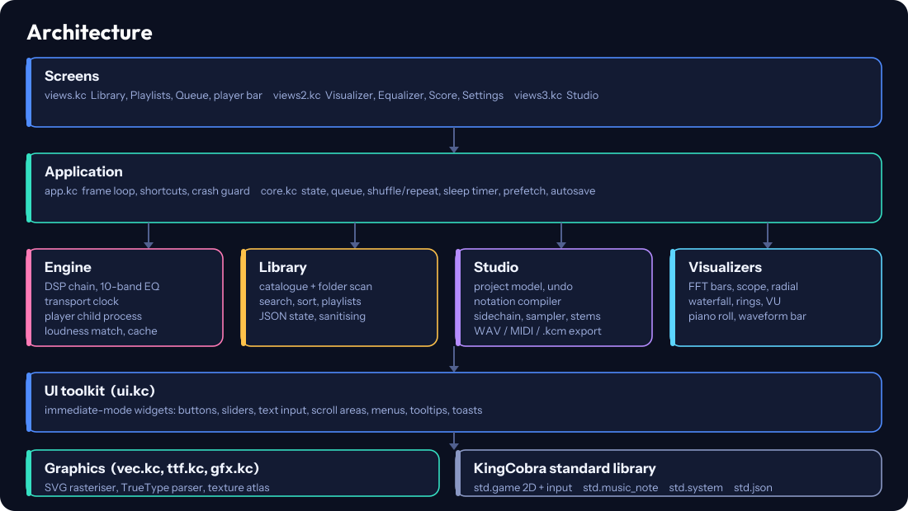
</p>

| File | Role |
|---|---|
| `main.kc` | entry point, command-line flags |
| `src/app.kc` | builds the app, runs the guarded frame loop, keyboard shortcuts |
| `src/core.kc` | application state and every verb: play, queue, shuffle, sleep timer, prefetch, autosave |
| `src/engine.kc` | DSP chain, non-blocking playback, transport clock, loudness matching, cache limit |
| `src/render_worker.kc` | background process that renders tracks |
| `src/library.kc` | catalogue, folder scan, search and sort, playlists, JSON persistence |
| `src/studio.kc` | production engine: project model, generators, notation compiler, render, export |
| `src/viz.kc` | visualizers, waveform bar, piano roll |
| `src/ui.kc` | immediate-mode widget toolkit |
| `src/views.kc`, `views2.kc`, `views3.kc` | screens |
| `src/vec.kc`, `ttf.kc`, `gfx.kc` | SVG rasteriser, TrueType parser, texture-atlas graphics layer |

> KingCobra creates a separate module instance for every `import`, so module-level variables are not shared between files. All application state therefore lives in one object that is passed around explicitly.


<h2 id="graphics">&nbsp;Graphics: SVG icons and real fonts</h2>

`std.game` draws rectangles, bitmaps and an 8x8 pixel font. Everything else here is KingCobra code:

* **`src/vec.kc`** parses SVG (paths with `M L H V C S Q T A Z`, `circle`, `ellipse`, `rect`, `line`, `polyline`, `polygon`, groups, transforms, fill, stroke, opacity, fill-rule, linecap, `style`) and rasterises it with exact-area anti-aliasing.
* **`src/ttf.kc`** reads TrueType fonts: `head`, `maxp`, `hhea`, `hmtx`, `cmap` (formats 4 and 12), `loca`, `glyf` including composite glyphs.
* **`src/gfx.kc`** keeps glyphs, icons, discs and rounded corners in one texture atlas and draws them as tinted sprites. Text is proportional, UTF-8, with regular, bold and display weights.

Icons are plain `.svg` files in `assets/icons/`, tinted by the theme at draw time. To add one:

```bash
cat > assets/icons/bell.svg <<'EOF'
<svg xmlns="http://www.w3.org/2000/svg" viewBox="0 0 24 24">
  <g fill="none" stroke="#000" stroke-width="2" stroke-linecap="round" stroke-linejoin="round">
    <path d="M6 16V11a6 6 0 0 1 12 0v5l2 2H4z"/><path d="M10 21h4"/>
  </g>
</svg>
EOF
```

```kingcobra
ui.icon("bell", cx, cy, 20, T.accent);   // any theme colour
```

Fonts live in `assets/fonts/` (Instrument Sans and Outfit, SIL Open Font License). Drop in other static TrueType (`glyf`) fonts with the same file names to restyle the app. If a font or icon is missing the toolkit falls back to the built-in bitmap font and drawn icons. First-frame warm-up is about 0.25 s; afterwards frames take 2 to 7 ms.


<h2 id="configuration-and-data">&nbsp;Configuration and data</h2>

Everything lives in `~/.cobra_music` (or `$KC_MUSIC_HOME`):

| Path | Content |
|---|---|
| `state.json` | settings, EQ, volume, favorites, play counts, playlists |
| `cache/` | rendered tracks (size-limited, oldest evicted first) |
| `projects/` | Studio projects, including `_autosave.json` |
| `exports/` | WAV, MIDI and stem exports |
| `error.log` | caught errors with timestamps |


<h2 id="testing">&nbsp;Testing</h2>

Tests drive the real application headlessly: they inject mouse and keyboard events, render frames and assert on the result.

| Suite | Checks | Covers |
|---|---|---|
| `tests/ui_test.kc` | 38 | search, sorting, menus, playback, seeking, volume, EQ, playlists, persistence |
| `tests/studio_test.kc` | 18 | sequencer and piano-roll clicks, undo, render, save / open, exports |
| `tests/mature_test.kc` | 38 | velocity, sidechain, sampler, stems, drag editing, crash guard, cache limit |
| `tests/gfx_test.kc` | 29 | SVG rasteriser accuracy, TrueType parsing, text measurement, atlas |

```bash
export KC_MUSIC_SILENT=1
KC_MUSIC_HOME=/tmp/cm_t kingcobra run tests/ui_test.kc
KC_MUSIC_HOME=/tmp/cm_t kingcobra run tests/studio_test.kc
KC_MUSIC_HOME=/tmp/cm_t kingcobra run tests/mature_test.kc
kingcobra run tests/gfx_test.kc
kingcobra check .            # type-check every file
```

###  Regenerating the documentation assets

The banner, badges, architecture diagram and screenshots are produced by KingCobra programs too:

```bash
kingcobra run tools/readme_assets.kc                      # SVG banner, badges, diagram, tinted icons
kingcobra run tools/screenshots.kc                        # headless screenshots -> docs/screenshots/raw
python3 tools/optimize_png.py docs/screenshots/raw docs/screenshots   # optional, needs Pillow
```


<h2 id="project-layout">&nbsp;Project layout</h2>

```text
cobra_music/
├── main.kc                  entry point
├── src/                     application, engine, studio, toolkit, graphics
├── assets/
│   ├── icons/               35 SVG icons
│   └── fonts/               Instrument Sans, Outfit (+ OFL licenses)
├── music/                   three original .kcm scores
├── tests/                   ui, studio, mature, gfx suites + screenshot driver
├── tools/                   README asset and screenshot generators
└── docs/
    ├── img/                 banner, badges, architecture diagram, tinted icons
    └── screenshots/
```

<h2 id="limitations">&nbsp;Limitations</h2>

* Changing volume, EQ or speed re-renders the rest of the track, so there is a short gap (about 0.1 to 0.4 s) when you release a control.
* The window size is fixed at start-up (`--size WxH`); `std.game` has no live-resize call.
* Fonts have no kerning or hinting (grayscale anti-aliasing only).

<h2 id="credits-and-license">&nbsp;Credits and license</h2>

* Code: MIT License, see [LICENSE](LICENSE).
* Fonts: [Instrument Sans](assets/fonts/InstrumentSans-OFL.txt) and [Outfit](assets/fonts/Outfit-OFL.txt), SIL Open Font License 1.1.
* Icons: original SVG artwork drawn for this project (24 x 24 grid, 2 px stroke).
* Built with [KingCobra](https://github.com/DivyanshuSinha136) by Divyanshu Sinha.
